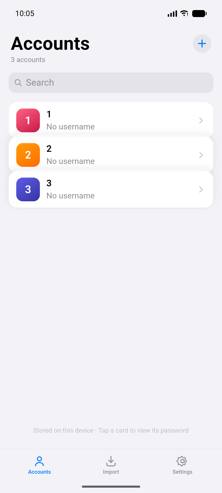
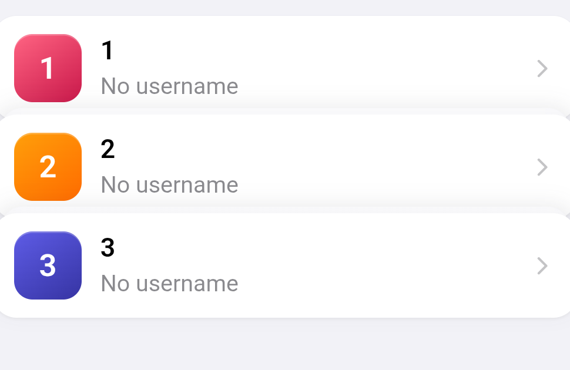

<div align="center">

<h1>Mixa Vault</h1>

<p>A local-first Android password manager.</p>

<p><strong><a href="https://d1irgger.github.io/MixaVault/">Live Preview →</a></strong></p>

<p>
<a href="https://github.com/d1irgger/MixaVault/releases/latest">Download APK</a> ·
<a href="README.md">中文</a>
</p>

<p><code>0.9.2</code> · <code>Android 10+</code> · <code>On-device AI</code> · <code>Encrypted Backup</code></p>

</div>

> The online page contains screenshots, features, install steps, and file locations. This README keeps only folded summaries.

<details>
<summary><strong>About</strong></summary>

<br>

A personal Android password manager. The UI is an iOS-style grouped list, data stays on-device, and AI extraction runs completely offline.

- No network permission
- No ads or telemetry
- Plain JSON and encrypted `.mixa` backups

</details>

<details>
<summary><strong>Features</strong></summary>

<br>

| Area | Details |
|---|---|
| Accounts | Search, add, edit, delete |
| Passwords | Show/hide, sensitive clipboard copy |
| Import | JSON, CSV, TXT, Markdown, HTML |
| On-device AI | Needle 2 extraction for Chinese labels and three-line notes |
| Backup | Plain JSON or AES-GCM encrypted `.mixa` |
| UI | Light/dark, Chinese/English |

</details>

<details>
<summary><strong>Screenshots</strong></summary>

<br>

<table align="center">
  <tr valign="top">
    <td align="center">
      
      <br><sub>Account list</sub>
    </td>
    <td align="center">
      
      <br><sub>Account cards</sub>
    </td>
  </tr>
</table>

</details>

<details>
<summary><strong>Security</strong></summary>

<br>

- Local accounts are plaintext JSON in the app's private directory, with no master password.
- The encrypted backup switch only affects exported `.mixa` files.
- Backup passwords are not stored and cannot be recovered.
- The app has no network permission and uploads no accounts or logs.
- Android auto-backup is disabled.
- Uninstalling the app or clearing data deletes local accounts.

> An unlocked or rooted device, or a debug build, may still expose local plaintext data.

</details>

<details>
<summary><strong>Install & Upgrade</strong></summary>

<br>

Download the latest APK from [GitHub Releases](https://github.com/d1irgger/MixaVault/releases/latest).

| Case | Action |
|---|---|
| First install | Allow installation from unknown sources |
| Same-signature update | Install over the existing app; data stays |
| Debug / old signature | Export `.mixa`, uninstall, install, import |
| AI support | `arm64` devices only |

GitHub releases do not update in the background. Download and install manually, or use Obtainium to follow releases.

</details>

<details>
<summary><strong>Backup & Paths</strong></summary>

<br>

| Content | Location |
|---|---|
| Plain export | `Download/MixaVault` |
| Encrypted backup | `Download/MixaVault/backups` |
| Diagnostics | `Download` |

Restore:

```text
Import → choose .mixa → enter password
```

</details>

<details>
<summary><strong>Build & Docs</strong></summary>

<br>

```powershell
cd mixa-vault
.\gradlew.bat assembleRelease
```

- [BUILD.md](BUILD.md)
- [COMPATIBILITY.md](COMPATIBILITY.md)
- [GITHUB.md](GITHUB.md)
- [TRAINING.md](TRAINING.md)
- [CHANGELOG.md](CHANGELOG.md)

</details>

<details>
<summary><strong>Third Party & License</strong></summary>

<br>

Needle 2 is published by Cactus Compute under Apache-2.0. See [THIRD_PARTY_NOTICES.md](THIRD_PARTY_NOTICES.md).

Application code is licensed under MIT. See [LICENSE](LICENSE).

</details>
