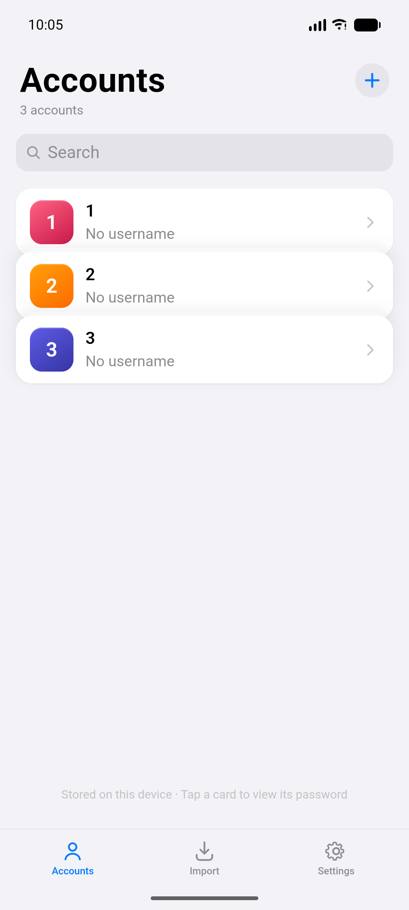
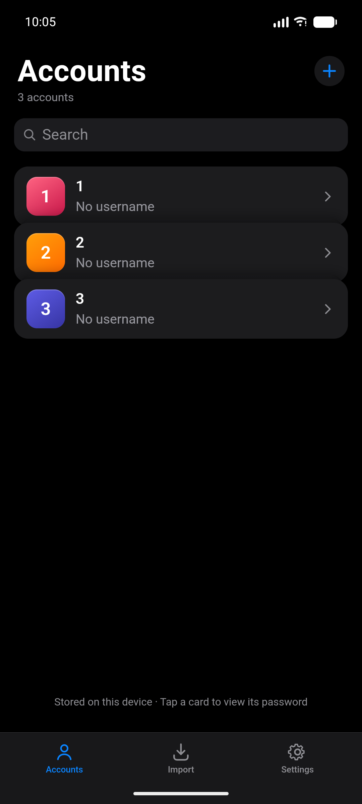

# 密匣 · Mixa Vault

中文 | [English](README.en.md)

个人自用的 Android 账户密码管理器。界面使用 WebView，数据由本地 Python 处理，AI 识别完全在设备端运行。

当前版本：`0.9.2`

<table>
  <tr>
    <td></td>
    <td></td>
  </tr>
</table>

## 功能

- iOS 风格账户列表、搜索、添加、编辑、删除。
- 密码显示/隐藏、敏感剪贴板复制。
- 自动跟随系统浅色/深色模式和中英文。
- 卡片展开查看密码、网址、备注。
- JSON / CSV / TXT / Markdown / HTML 导入。
- 本地 Needle 2 AI 识别，支持常见中文标签和三行纯文本。
- 可选加密备份，支持 `.mixa` 导入恢复。
- 明文 JSON 和诊断日志直接写入 Download，无需手动保存。
- 无网络权限、无广告、无分析 SDK、无遥测。

## 安全说明

- 账户数据保存在应用私有目录，默认是明文 JSON。
- App 打开不需要主密码。
- “加密备份”只作用于导出的 `.mixa` 文件，不改变本地数据。
- 加密备份使用标准认证加密；密码不保存，忘记后无法恢复。
- 没有申请网络权限，不会上传账户或日志。
- 已关闭 Android 自动备份。
- 卸载 App 或清除应用数据会删除本地账户。

如果设备已解锁、被 root，或使用调试版，仍可能读取本地明文数据。

## 安装

从 GitHub Releases 下载最新 APK。

- Android 10 及以上。
- `arm64` 真机支持本地 AI；`x86_64` 模拟器不显示 AI 按钮。
- 首次安装需要允许“安装未知应用”。

### 升级

只要 APK 使用同一签名，并且 `versionCode` 更高，就可以直接覆盖安装，**不需要卸载**，账户数据会保留。

只有以下情况需要先导出 `.mixa`、卸载旧版、再安装：

- 从 debug 签名版本升级
- 签名证书发生变化
- 应用包名发生变化

GitHub 版没有后台自动更新；可以手动下载覆盖安装，或使用 Obtainium 等工具跟踪 Release。

## 备份

设置 → 文件：

- 关闭“加密备份”：导出明文 JSON 到 `Download/MixaVault`。
- 打开“加密备份”：导出 `.mixa` 到 `Download/MixaVault/backups`。

恢复：

```text
导入 → 选择 .mixa → 输入密码
```

诊断日志入口：

```text
设置 → 诊断日志 → 导出
```

## 构建

完整构建步骤见 [BUILD.md](BUILD.md)。

```powershell
cd mixa-vault
.\gradlew.bat assembleRelease
```

需要 JDK 21、Android SDK 35、NDK、CMake 和 64 位 Python 3.14。具体版本见 [COMPATIBILITY.md](COMPATIBILITY.md)。

## 文档

- [BUILD.md](BUILD.md)：从零构建 APK
- [COMPATIBILITY.md](COMPATIBILITY.md)：工具链与兼容性
- [GITHUB.md](GITHUB.md)：仓库和 Release 流程
- [TRAINING.md](TRAINING.md)：AI 离线微调
- [CHANGELOG.md](CHANGELOG.md)：版本记录

## 第三方

Needle 2 由 Cactus Compute 发布，Apache-2.0。  
详见 [THIRD_PARTY_NOTICES.md](THIRD_PARTY_NOTICES.md)。

## License

应用代码使用 MIT License，见 [LICENSE](LICENSE)。
