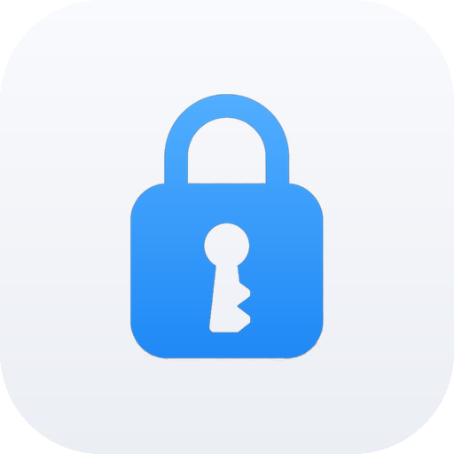

# 密匣 · Mixa Vault

个人自用的 Android 账户密码管理器。界面使用 WebView，业务逻辑由 Chaquopy 内嵌 Python 处理，AI 使用本地 Needle 2。

**首个发行版系列：`0.9.x`。当前版本：`0.9.2`（versionCode 19）**




## 特点

- iOS 风格分组列表、顶部/底部毛玻璃、Sheet 和卡片展开动画。
- 自动跟随系统浅色/深色模式与中英文。
- 账户搜索、添加、编辑、删除、密码显示/隐藏、敏感剪贴板复制。
- 账户卡片展开后显示密码、网址、备注，不再重复显示标题和账号。
- JSON / CSV / TXT / Markdown / HTML 导入，支持直接粘贴文本。
- 自动去重：标题 + 账号相同的记录跳过。
- 本地 Needle 2 AI 识别（仅 arm64 真机）。
- 可选 AES-256-GCM 加密备份，直接写入 `Download/MixaVault/backups`。
- 明文 JSON 直接写入 `Download/MixaVault`，不弹系统保存选择器。
- 顶部细横幅提示成功状态，包含图标、标题和两行路径。
- 诊断日志一键写入 `Download` 根目录。
- 无网络权限、无广告、无分析 SDK、无遥测；仅集成 Needle 2 本地推理。

## 安全模型

默认情况下，账户数据保存在应用私有目录：

```text
/data/data/com.mixa.vault/files/vault.json
```

这是**明文 UTF-8 JSON**，这是当前版本的明确取舍：

- 打开 App 不需要主密码。
- 加密开关只作用于**导出备份**，不改变本地 `vault.json`。
- 已设置 `android:allowBackup="false"`，避免系统自动备份明文数据。
- 应用没有 `INTERNET` 权限。
- Debug APK 允许 `run-as` 调试；正式安装请使用 release 签名包。
- 能接触到已解锁设备、root 环境或调试备份的人仍可能读取本地数据。

加密备份：

```text
PBKDF2-HMAC-SHA256  210,000 次
AES-256-GCM
随机 salt 16 字节
随机 IV 12 字节
```

密码不保存。忘记密码无法恢复备份。

## 技术结构

```text
mixa-vault/
├─ app/src/main/
│  ├─ java/com/mixa/vault/
│  │  ├─ MainActivity.kt          WebView、JS Bridge、SAF、MediaStore、剪贴板
│  │  └─ NeedleBridge.kt          Needle 模型加载、中文预处理、分块推理
│  ├─ python/vault.py             JSON 存储、增删改、导入、去重、诊断日志
│  ├─ cpp/
│  │  ├─ CMakeLists.txt
│  │  ├─ needle_jni.cpp           C API JNI 桥
│  │  └─ needle/android-arm64/    needle.h + libneedle.a
│  ├─ assets/
│  │  ├─ index.html
│  │  ├─ styles.css
│  │  ├─ app.js
│  │  ├─ icon-splash.png
│  │  └─ needle/needle2.cact      约 13.7 MB
│  ├─ res/                        主题、自适应图标
│  └─ AndroidManifest.xml
├─ docs/                          预览图、图标源文件
├─ README.md
├─ BUILD.md
├─ COMPATIBILITY.md
├─ TRAINING.md                    Needle 2 LoRA 离线流程
├─ GITHUB.md                     从新建仓库到 Release 的发布流程
└─ CHANGELOG.md
```

## 导入格式

### JSON

```json
[
  {
    "title": "Apple ID",
    "username": "me@icloud.com",
    "password": "your-password",
    "url": "https://appleid.apple.com",
    "note": "双重认证"
  }
]
```

也支持 `{ "accounts": [...] }`、`name`、`账号`、`用户名`、`密码`、`网址`、`备注` 等字段。

### CSV

```csv
title,username,password,url,note
Apple ID,me@icloud.com,secret,https://appleid.apple.com,双重认证
```

支持引号、逗号字段，以及 Chrome / Apple 密码导出常见表头。

### 纯文本 / Markdown / HTML

支持：

```text
标题
账号：me@example.com
密码：secret
网址：https://example.com
备注：测试
```

也支持三行格式、`名称 邮箱 密码` 单行、Markdown 表格、HTML 表格和 HTML 标题段落。

### 加密备份

```text
导入 → 选择 .mixa → 输入密码 → 解密 → 导入
```

## 本地 AI（Needle 2）

- 模型：`app/src/main/assets/needle/needle2.cact`（13,737,807 B）
- 引擎：`app/src/main/cpp/needle/android-arm64/libneedle.a`
- 仅 `arm64-v8a` 真机显示“AI 识别”。
- x86_64 模拟器编译空实现，不会崩溃，但没有 AI。
- 中文标签会先规范成 `title / username / password / url / note`。
- 支持常见中文标签、三行纯文本、`名称 邮箱 密码` 单行。
- 自然语言长句建议做 LoRA 微调：[TRAINING.md](TRAINING.md)。

## 构建

完整步骤见 [BUILD.md](BUILD.md)。

最短路径：

```powershell
$env:JAVA_HOME = "C:\Users\s2086\.jdks\jbr-21.0.11"
$env:Path = "$env:JAVA_HOME\bin;$env:Path"

cd mixa-vault
.\gradlew.bat assembleDebug --offline

adb -s emulator-5554 install -r app\build\outputs\apk\debug\app-debug.apk
```

必须安装：

```text
JDK 21
Android SDK 35
Build Tools 35.0.0
NDK 30.0.16248370
CMake 4.1.2
Python 3.14（64 位）
```

APK：

```text
app/build/outputs/apk/debug/app-debug.apk
app/build/outputs/apk/release/app-release.apk
```

正式安装使用 release APK。签名密钥位于本机 `.keystore/`，不会进入源码包。

工具链、SDK、WebView API 和升级注意事项见 [COMPATIBILITY.md](COMPATIBILITY.md)。

## 文件位置

| 内容 | 位置 |
|---|---|
| 本地账户 | `/data/data/com.mixa.vault/files/vault.json` |
| 明文导出 | `Download/MixaVault/mixa-vault-日期.json` |
| 加密备份 | `Download/MixaVault/backups/mixa-vault-backup-日期-时间.mixa` |
| 诊断日志 | `Download/mixa-vault-diagnostics-日期-时间.txt` |
| 模型 | `assets/needle/needle2.cact` |
| 静态库 | `cpp/needle/android-arm64/libneedle.a` |

## 浏览器预览

```powershell
cd app/src/main/assets
py -3.14 -m http.server 8765
```

访问 `http://127.0.0.1:8765/`。浏览器模式不写磁盘，仅用于调 UI。

## GitHub 发布与升级

从 GitHub 分发时，用户**不需要每次卸载旧版**。

Android 允许原地覆盖升级，前提是：

```text
applicationId 相同
签名证书相同
versionCode 比旧版大
```

所以发布新版本时：

1. 保持 `applicationId = com.mixa.vault`
2. 使用同一个 D1rector release keystore
3. 递增 `versionCode` 和 `versionName`
4. 构建 `assembleRelease`
5. 上传新的 APK 到 GitHub Release

用户下载新 APK 后直接点安装，系统会显示“更新”，账户数据保留。

### GitHub 不会自动更新

从 GitHub 侧载的 APK 没有 Play Store 那样的后台自动更新。用户可以：

- 手动下载新 Release 覆盖安装
- 使用 Obtainium 跟踪 GitHub Release
- 后续上架 F-Droid / Google Play

需要卸载的场景只有：

- 签名证书变了
- applicationId 变了
- 安装的是 debug / 其他开发者的包

密钥丢失或更换会迫使所有用户卸载重装，所以必须长期保存：

```text
mixa-vault/.keystore/release-d1rector.keystore
mixa-vault/keystore.properties
```

## 版本

当前为**首个发行版系列 `0.9.x`**，当前补丁 `0.9.2`。  
后续版本号按改动递增：`0.9.3` 修复、`0.10.0` 功能。

## 发布

GitHub 仓库、签名 secrets、Release 上传和版本更新流程见 [GITHUB.md](GITHUB.md)。

## 第三方

Needle 2 由 Cactus Compute 发布，Apache-2.0。模型和 arm64 静态库位于 `assets/needle` 与 `cpp/needle`，SHA-256 已与官方 Hugging Face 文件核对。

- <https://huggingface.co/Cactus-Compute/needle2>
- <https://cactuscompute.com/needle>

## License

应用代码使用 MIT License，见 [LICENSE](LICENSE)。

Needle 2、AndroidX 使用 Apache-2.0，见 [THIRD_PARTY_NOTICES.md](THIRD_PARTY_NOTICES.md) 和 [Apache-2.0](LICENSES/Apache-2.0.txt)。
